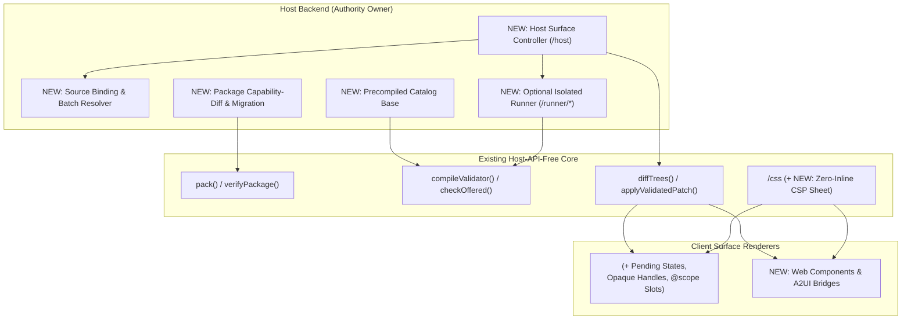

# Independent Evaluation of Liveframe & Host Capability Expansion

## Executive Thesis

Liveframe (`@arnilo/liveframe` v0.2.1, specified in [spec.md](../docs/spec.md)) occupies a distinct and unusually well-disciplined architectural niche: **untrusted, runtime-installable product UI that looks indistinguishable from compiled first-party screens while running zero untrusted code or raw CSS in the browser.**

Most competing technologies optimize for **one** half of this problem and sacrifice the other:
- **Sandboxed client extension runtimes** (*Shopify Remote DOM*) and **iframe micro-app protocols** (*MCP Apps / MCP-UI*, *OpenAI Apps SDK*) prioritize arbitrary client interactivity, paying for it with browser worker/iframe boot costs, clipped overlays, duplicated bundles, or fractured design-system fidelity.
- **Generative UI wire protocols** (*Google A2UI*, *Vercel `json-render`*) and **classic Server-Driven UI** (*DivKit*, *Adaptive Cards*) eliminate client code execution, but either treat UI purely as ephemeral LLM-streamed JSON without a persistent software-engineering lifecycle (packaging, composed TSX modules, deterministic hashes, visual CI capture) or punt runtime theming, contrast enforcement, and causal intent verification entirely to ad-hoc host code.

At the same time, an unsparing evaluation of v0.2.1 reveals a sharp **"Host Integration Chasm"**: Liveframe's strict adherence to [Law 4](../docs/spec.md#L45) (*"A widget never holds authority"*) and a host-API-free core currently leaves every adopting host to hand-build production surface orchestration, [`manifest.sources`](../docs/spec.md#L370) binding evaluation, true isolation sandboxes, cross-surface coordination, and upgrade state migrations.

---

## Part I: Independent Evaluation vs. Existing Solutions

### 1. Landscape Comparison Matrix

| Dimension | Liveframe (`0.2.1`) | Google A2UI (`a2ui.org`) | Vercel `json-render` / AI SDK | Shopify Remote DOM | MCP Apps / MCP-UI (`ui://`) | DivKit / Adaptive Cards | React Server Components |
| :--- | :--- | :--- | :--- | :--- | :--- | :--- | :--- |
| **Authoring Model** | **Dual:** Persistent typed TSX packages ([`pack`](../src/pack/pack.ts#L8-L38)) **+** ephemeral agent JSON ([`renderElements`](../docs/spec.md#L396)) | Ephemeral / streaming declarative JSON | LLM-generated JSON constrained by Zod/React schemas | Stateful JS/TSX (Preact/React) inside client sandbox | Full HTML/JS/CSS micro-app bundles | Static JSON layout templates & custom expression DSLs | First-party server-side TSX (build/deploy time) |
| **Where Untrusted Code Runs** | **Host backend sandbox only** ([Law 1](../docs/spec.md#L41)); browser receives validated JSON | None (LLM or remote agent emits JSON) | None (LLM emits JSON) | Browser Web Worker or hidden iframe | Browser double-iframe sandbox | None (JSON templates) | **Not untrusted** (runs with full server authority) |
| **Styling & Design System Authority** | **3-layer data engine:** DTCG themes + WCAG contrast gate + slot/state recipes → 3 CSS sheets ([`/css`](../src/css/design-system.ts#L219-L241)) | Host components own all styling; no portable recipe/theme projection | Hardcoded in host React components | Locked to host catalog props (e.g., Polaris) | **Owned by remote widget** (visually isolated from host) | Inline JSON visual attributes (colours/margins in payload) | Arbitrary CSS / Tailwind (zero style boundary) |
| **Cross-Node Client Interactivity** | **Server round trip** (Tier 2 `setState`); Tier 1 is single-primitive local | Client-side reactive data-model bindings + agent round trips | Host React state / LLM tool round trips | **60fps local** inside Web Worker (0 network round trips) | **60fps local** inside iframe (0 network round trips) | Limited JSON state expressions / actions | Client Components (`"use client"`) bundled at deploy |
| **Causal Intent Verification** | **Built-in:** [`checkOffered`](../docs/spec.md#L576) verifies `(surfaceId, revision, nodeId, event)` against served tree | Host-defined action callbacks | Host-defined callbacks | RPC callback references | `postMessage` JSON-RPC | Host action handlers | Server Actions (closure-encrypted args, deploy-bound) |
| **Agent Verification Loop** | **Built-in:** [`createAuthoring`](../src/authoring/index.ts) + `liveframe mcp` + multi-axis PNG, ARIA YAML & `--layout` geometry | Schema validation only | Schema validation only | Dev CLI preview (human-oriented) | Manual client inspection | Visual JSON playground | Standard web dev tools |
| **Client Targets** | React 19 ([`/react`](../src/react/renderer.tsx#L92-L337)) + Baseline 2024 CSS | Web (Lit/React/Angular), Flutter, Compose, SwiftUI | React | Web DOM, React Native | Any browser/webview supporting iframes | iOS, Android, Web | React (Web) |

---

### 2. Where Liveframe Genuinely Leads the Field

1. **Unifying Persistent Software Engineering with Ephemeral Generative UI**
   Generative UI frameworks like *A2UI* and *`json-render`* treat dynamic UI almost exclusively as transient LLM JSON output. Once an agent or user wants to **keep** a custom queue, inspector, or dashboard across launches, raw JSON trees crumble—they cannot express filtering, pagination cursors, conditional sub-views, or shared sub-components cleanly. Liveframe supports *both* ephemeral JSON ([`renderElements`](../docs/spec.md#L396)) for chat turns *and* immutable, RFC 8785 canonically hashed TSX packages ([`pack`](../src/pack/pack.ts#L8-L38), [`verifyPackage`](../docs/spec.md#L449)) with required fixture scenarios and typed codegen ([`liveframe gen`](../docs/spec.md#L387)).

2. **Look vs. Structure Separation & Zero-Rerender Design-System Switching**
   In almost every SDUI system (*DivKit*, *Adaptive Cards*), authors leak visual branding (hex colours, pixel paddings, border styles) into payloads, or the catalog ossifies into coarse product-shaped widgets (`TaskQueueCard`) that block new layouts—the exact failure mode documented in [2026-10-21-2017-liveframe-founding-model.md](../decision-logs/2026-10-21-2017-liveframe-founding-model.md). Liveframe's Phase 0 proof ([spec.md §12](../docs/spec.md#L736-L781)) demonstrated `< 1%` pixel divergence on complex production screens using only ~23 primitives by strictly splitting **structure** (token-constrained responsive `@container lf` style props) from **look** (DTCG 2025.10 themes with install-time WCAG 2.x contrast-pair enforcement and `<kind>.<variant>.<slot>.<state>` recipes). Swapping themes or entire design systems flips scope attributes in `≤ 16.67 ms` across Chromium, Firefox, and WebKit without re-running widget code.

3. **Closed-Loop Multimodal Agent Authoring (Without Granting Runtime Authority)**
   Giving coding agents [`createAuthoring`](../src/authoring/index.ts) and `liveframe mcp` with bounded 20-error structured pointers, automatic [`sourceOutcome`](../docs/spec.md#L428) failure-state expansion (`ok`, `unauthorized`, `unavailable`, `stale`, `failed`), and headless [`capture_preview`](../docs/spec.md#L859) returning PNGs, ARIA snapshots, and integer bounding-box/overflow geometry (`layout: true`) solves the #1 failure mode of AI-generated UI: **hallucinated layouts that compile cleanly but overflow or misalign visually.**

4. **Defense-in-Depth Validation & Causal Intent Integrity**
   Liveframe treats its own storage, runner, and network transport as untrusted ([security.md](../docs/security.md#L5-L15)):
   - Widget-authored schemas ban regex `pattern` ([spec.md §5](../docs/spec.md#L119)), closing ReDoS vectors on host and browser threads.
   - [`compileValidator`](../src/validate/compile.ts#L116-L126) builds CSP-safe closures (~1.3 µs/node, zero `eval`/`new Function`) shared between single-pass `render()` and browser `<Surface>` arrival checks.
   - [`checkOffered`](../docs/spec.md#L576) ensures a client cannot forge an action or arguments that the exact currently-served tree revision did not offer on that specific `nodeId` and `event`.

5. **Polyglot Host Portability & Executable Conformance**
   Shipping self-contained zero-global ES bundles (`validator.bundle.js`, `runner-kit.bundle.js`), a 53-case language-neutral validation corpus, RFC 8785 + SHA-256 package vectors, and drop-in host conformance suites ([`/conformance`](../docs/spec.md#L806-L807)) makes non-TypeScript host kernels (like Clay's Rust + `deno_core` architecture in [clay-0.2.1-requests.md](requests/clay-0.2.1-requests.md)) genuinely verifiable rather than aspirational.

---

### 3. Honest Weaknesses & Friction Points Compared to Alternatives

> [!WARNING]
> Where existing tools beat Liveframe today is not accidental bugs—most stem directly from Liveframe's strict boundaries. Recognizing these exact pressure points shows how to expand host capability without breaking the core model.

1. **The Tier-1 vs. Tier-2 Interactivity Cliff (vs. *Shopify Remote DOM* & *A2UI*)**
   Tier 1 interactions live strictly inside a *single* primitive (opening a menu, typing in an uncommitted `textField`). The moment an interaction spans two nodes—typing a search query that live-filters 30 visible rows, toggling a switch that reveals conditional form fields, or computing a live total across three numeric inputs—Liveframe requires a **Tier 2 `setState` backend round trip**. Over localhost/IPC (like Clay's Tauri desktop app, ~5–8 ms) this feels instant; over high-latency mobile/WAN networks (100–250 ms RTT) or offline-capable apps, *Shopify Remote DOM* (local Web Worker state) and *A2UI* (client-side data-model bindings) feel noticeably snappier.

2. **The Production "Host Integration Chasm" (Exposed in [`examples/demo-host/server.ts`](../examples/demo-host/server.ts#L59-L191))**
   Liveframe ships rich *draft* orchestration ([`createPreview`](../src/preview/session.ts#L15-L155)), yet provides **zero runtime orchestration helper for production surfaces**. Inspecting the codebase reveals that while [`checkSource`](../src/formats/manifest.ts#L167-L193) validates `manifest.sources` parameter bindings (`{ from: "params" | "state" | "context", path }`) at install time, **no library function evaluates those bindings at request time** (in fact, [`examples/demo-host/server.ts`](../examples/demo-host/server.ts#L81-L85) passes `data: {}`). Every host must hand-roll:
   - Evaluating `{ from, path }` source parameter bindings and deduplicating concurrent source reads;
   - Tracking per-viewer `(surfaceId, revision, servedTree, validator)` maps for [`checkOffered`](../docs/spec.md#L576);
   - Computing canonical input-hash render caches ([spec.md §8](../docs/spec.md#L580));
   - Diffing consecutive revisions via [`diffTrees`](../src/validate/patch.ts#L136-L202) and managing whole-tree fallback on `stale-patch`.

3. **No Turnkey Isolation Boundary**
   [`security.md`](../docs/security.md#L18-L20) candidly states that neither `inProcessRunner()` nor `workerRunner()` is a sandbox—and because `workerRunner()` reuses one worker across packages, a malicious widget can intercept and spoof subsequent renders or access `fs`/network globals. Hosts with dedicated platform teams (Synapta, Clay) build `deno_core` or bubblewrap isolates using `runner-kit.bundle.js`, but a typical SaaS team adopting Liveframe from npm faces a steep security cliff.

4. **O(Tree) Validation on Incremental Patches & Per-Manifest Catalog Recompilation**
   - In `0.2.1`, [`applyPatch`](../src/validate/patch.ts#L34-L133) is purely structural: both host and `<Surface>` still run `validateTree` across the **entire tree** on every 185-byte patch ([clay-0.2.1-requests.md](requests/clay-0.2.1-requests.md#L147) measured `2.38 ms` p95 at 1,501 nodes just to change 10 bytes).
   - [`compileValidator`](../src/validate/compile.ts#L116-L126) re-validates and recompiles the entire `Catalog` and `Capabilities` from scratch for every `Manifest` (`~0.73 ms` per manifest on a 24-primitive catalog), doing redundant work when a page mounts 15 placements sharing one catalog.

5. **Flat Surface Topology, React-Only Client & Inline-Style CSP Requirement**
   - Surfaces cannot nest ([spec.md §6.4](../docs/spec.md#L251)), preventing user/agent-authored *layout* widgets that frame other host placements.
   - Only React 19 is supported on the client, whereas *A2UI* and *DivKit* reach Flutter, SwiftUI, Jetpack Compose, and Web Components natively.
   - Node layout props require `style-src-attr 'unsafe-inline'` ([spec.md §6.4](../docs/spec.md#L287)), blocking strict-CSP enterprise hosts.

---

## Part II: How to Expand Liveframe to Provide Hosts with More Capability

> [!IMPORTANT]
> Every expansion below preserves Liveframe's **Four Laws** ([spec.md §2](../docs/spec.md#L40-L46)): widget code never runs in the browser, UI trees remain validated data, look stays under theme/recipe authority, and **hosts retain 100% of data, storage, and action authority** through injected hooks rather than ambient globals.

### Tier A — Production Host Runtime & Performance Multipliers *(Highest Immediate Leverage)*

#### 1. Host-API-Free Production Surface Controller & Source-Binding Engine (`@arnilo/liveframe/host`)
Give production hosts what [`createPreview`](../src/preview/session.ts#L15-L155) already gives authoring hosts, without touching transport, auth, or databases:
- **`bindSources(manifest, { params, state, context })` & `resolveSources(...)`:** Evaluate `manifest.sources` `{ from, path }` bindings using the exact pointer semantics [`checkSource`](../src/formats/manifest.ts#L167-L193) validates at install time. When rendering a multi-widget page, deduplicate identical `(sourceName, canonicalJson(resolvedParams))` calls across placements in one batch, validate results once against `capabilities.sources[name].result`, and optionally wrap thrown/unauthorized/timed-out resolver calls into standard [`sourceOutcome`](../docs/spec.md#L428) envelopes.
- **`createSurfaceController({ catalog, capabilities, runner, resolveSource, dispatchAction, store? })`:** Manage per-viewer `(surfaceId, scope)` revision counters, retain the accepted `UiTree` for [`checkOffered`](../docs/spec.md#L576), compute the [spec.md §8](../docs/spec.md#L580) canonical input hash `(pkg.hash, catalogId, params, state, data, context)` to short-circuit no-op renders, and automatically emit either a whole `UiTree` or a `liveframe/tree-patch/1` delta when the client supplies `baseRevision`.
- **Why hosts care:** Collapses ~150 lines of delicate, security-critical state/revision/checkOffered boilerplate (like [`examples/demo-host/server.ts`](../examples/demo-host/server.ts#L75-L190)) into ~15 lines of pure capability injection.

#### 2. Precompiled Catalog Base (`compileCatalog`) & Incremental `O(|patch|)` Patch Validation
Eliminate the two largest remaining CPU taxes on high-density and high-frequency hosts:
- **`compileCatalog({ catalog, capabilities })`:** Validate and compile definitions, schemas, style rules, and capability maps *once* at host/browser startup (noted in [clay-adoption-requests.md](requests/clay-adoption-requests.md#L207)). Specializing a validator per widget manifest (`compiledCatalog.forManifest(manifest)`) then compiles only the manifest's `params`/`state`/`context` and action-subset checks, cutting startup cost across multi-placement dashboards by `> 10×`.
- **`applyValidatedPatch(validatedBase, patch, validator)`:** Because `validatedBase` is already proven valid and immutable, incremental validation only needs to run `checkNode` on `set`/`insert` targets, re-check `ChildRules` on touched parents, maintain an `O(1)`/`O(|patch|)` delta on `(nodeCount, byteCount, idSet)`, and verify `maxDepth` on inserted subtrees. It produces the exact same `Result<UiTree>` guarantees as whole-tree validation while dropping 1,500-node streaming validation cost from `~2.4 ms` to `< 0.05 ms`—and `<Surface>` can accept an optional `patch` prop directly.

#### 3. Reactive Source Subscriptions & Push Invalidation
Today, capabilities only model pull-on-render `sources` and user-triggered `actions`. Many host capabilities are **push-driven**: live task queues, streaming agent tool progress, filesystem/git watchers, telemetry feeds.
- **How to add it safely:** Keep widgets 100% pure and synchronous! Add host-side dependency tracking in the Surface Controller: because every placement declares which `(sourceName, resolvedParams)` tuples it read on its last render, a host calling `controller.invalidateSource("git.status", { repo })` (or pushing a new source value) automatically re-renders *only* subscribed placements, skips any placement whose output tree is unchanged, and hands the host ready-to-stream `TreePatch` payloads.

---

### Tier B — Turnkey Isolation, Governance & Enterprise Lifecycle

#### 4. Optional-Peer Isolated Sandbox Runners, Batch Execution & `runnerSuite()`
Close the #1 security barrier for mainstream adopters while keeping the core dependency-free:
- **Optional Isolated Reference Runner (`@arnilo/liveframe/runner/quickjs` or `/runner/isolated`):** Using the same optional-peer pattern as `playwright` and `@modelcontextprotocol/server`, ship a real capability-free sandbox runner embedding [`runner-kit.bundle.js`](../docs/spec.md#L801) with configurable heap limits (`maxMemoryBytes`), deterministic CPU interrupt budgets, fresh realm per untrusted package, and zero filesystem/network globals.
- **Batch Multi-Placement Rendering (`Runner.renderMany?`):** Allow hosts rendering an 8-widget workspace to cross the process/isolate IPC boundary once per request while re-validating each returned `UiTree` independently on the host ([synapta-adoption-requests.md LF-13](requests/synapta-adoption-requests.md#L234)).
- **Runner & CaptureBackend Conformance Suites ([backlog.md](backlog.md#L276-L285)):** Export `runnerSuite()` and `captureBackendSuite()` from `/conformance` so custom host sandboxes prove hash checking, timeout recovery, cross-realm rejection ([CL-17](requests/clay-0.2.1-requests.md#L155-L163)), and deterministic error shapes.

#### 5. Package Capability-Diff Governance (`classifyPackageChange`) & Provenance Envelopes
Liveframe classifies breaking vs. minor changes between two `Catalog` versions ([spec.md §5](../docs/spec.md#L135)), yet gives hosts no equivalent intelligence when an agent or third party proposes `widget@1.1.0` to replace `widget@1.0.0`.
- **`classifyPackageChange(prevPkg, nextPkg, capabilities)`:** Return a deterministic governance report:
  - *Privilege delta:* newly requested `actions` (flagging `confirm` and `irreversible` escalations) and newly requested `sources`;
  - *Contract delta:* breaking vs. compatible changes to `params`, `state`, and `context` schemas;
  - *Metadata delta:* changes to `description` and `meta`.
- **Why hosts care:** Enables **policy-driven auto-approval**—a host can let an AI agent auto-update layout/copy revisions while automatically routing any package that adds an `irreversible` action or sensitive data source to a human admin approval gate. Pair this with an optional WebCrypto Ed25519 signature envelope over `pkg.hash` so hosts can verify publisher authorship across environments.

#### 6. Declarative State & Params Schema Migrations
Currently, [`loadPlacement`](../docs/spec.md#L485) resets user `state` to `initialState` whenever a widget upgrade tightens or renames a state field, and fails closed if stored placement `params` lack a newly required property.
- **Safe expansion:** Allow a manifest to declare pure, non-Turing-complete **declarative schema migrations** from prior major/minor versions (`rename`, `setDefault`, `drop`, `mapEnum`), validated at `pack()` time with zero code execution on the host thread before `loadPlacement` checks the migrated value against the new schema.

---

### Tier C — Richer Client UX & Multi-Surface Composition *(Without Breaking Law 1)*

#### 7. First-Class In-Flight Intent States (`pending`) & Declarative Optimistic Hints
Bridge the perceived latency gap against *Shopify Remote DOM* without running widget JS in the browser:
- **Async `onIntent` & Recipe `pending` State:** Allow `<Surface onIntent={(intent, origin) => Promise<void> | void}>` to track in-flight intents per `(nodeId, event)`. Expose `pending: boolean` in `implement()`'s `events` metadata map *and* add `[data-pending]` / `[aria-busy=true]` state support to CSS recipes so buttons, rows, and switches automatically show host-styled busy states and prevent double-submits without widget-level loading booleans.
- **Optimistic `setState` Projection:** For simple scalar Tier-2 intents (`state.set("selectedRow", id)` or `state.set("tab", "mine")`), allow `<Surface>` (or a primitive's `events` metadata) to reflect immediate selection/pressed ARIA state optimistically until the next `revision` arrives or the `onIntent` promise rejects.

#### 8. Typed Opaque Host Resource Handles (`handle("<resourceKind>")`)
When a host provides rich browser capabilities—a 100,000-point WebGL telemetry chart, a Monaco/CodeMirror buffer, a live PTY terminal, a map viewport, or a virtualized data grid—passing raw payloads through widget `data` → `render()` → JSON `UiTree` violates node/byte budgets, while passing plain `string` IDs ([clay-adoption-requests.md](requests/clay-adoption-requests.md#L209)) loses schema safety and origin verification.
- **Safe expansion:** Introduce a branded/tagged opaque handle convention in the schema language (e.g., `{ handle: "timeseries" }` or `resourceRef("editorBuffer")`). A host `source` returns a short signed/scoped handle token; the widget inspects summary metadata and binds the handle to a `<TimeSeriesChart series={data.cpu.handle} />` primitive; the validator verifies handle-kind compatibility at compile & render time; and the host's React primitive resolves the live stream directly in the browser without copying megabytes through the widget sandbox.

#### 9. Host-Mediated Surface Slots (`@scope` Isolation) & Cross-Surface State Linking
Unlock **composable workspaces**—where users or agents customize *multi-widget page layouts* as well as leaf widgets:
- **Scoped Placement Slots:** Use Baseline CSS `@scope ([data-lf-surface]) to ([data-lf-portal], [data-lf-surface])` (tracked in [backlog.md](backlog.md#L155-L161)) combined with a host-owned `<Slot name="inspector" />` pattern. A layout widget never imports or controls the child widget (preserving Law 4); it simply declares named structural regions that the host fills with independent `<Surface>` placements whose CSS variables and recipe rules cannot bleed across the `@scope` donut boundary.
- **Cross-Surface Host Bindings:** Allow a host `Placement` record's `params` to bind declaratively to another placement's scoped `state` (e.g., binding `inspector.params.taskId` to `{ fromPlacement: "main-queue", statePath: "selectedId" }`). Selecting a row in Surface A then drives Surface B cleanly through the host controller with zero client-side coupling.

---

### Tier D — Security Hardening, Agent Fidelity & Ecosystem Reach

#### 10. Strict Zero-Inline-Style CSP Projection ([backlog.md](backlog.md#L139-L145))
High-security enterprise hosts frequently enforce `style-src 'nonce-...'` without `style-src-attr 'unsafe-inline'`.
- **How to add it:** Add a pure `treeLayoutCss(tree, catalog): { css: string; classMap: ReadonlyMap<string, string> }` (or deterministic content-hashed atomic rule emitter) in `/css`. `<Surface layoutMode="sheet">` omits inline `style` attributes completely and attaches deterministic layout classes backed by a single host-nonce-authorized `<style>` element.

#### 11. Interactive Overlay Capture & Guarded Read-Only Live-Data Preview
Upgrade the agent authoring loop (`createAuthoring` / `liveframe mcp`) in two high-value ways:
- **Pre-Capture Interaction Steps ([backlog.md](backlog.md#L239-L245)):** Today `capture_preview` only screenshots resting trees, so agents are blind to open `dialog`, `menu`, `popover`, and `tooltip` layouts. Adding an optional `openNodeId?: string` or bounded `interactions` step before cell capture lets agents visually and geometrically (`--layout`) verify overlays without granting action authority.
- **Viewer-Scoped Live-Source Preview Hook:** Allow a host's `createAuthoring` config to optionally inject a read-only `resolvePreviewSource` callback. Agents can then test drafts against real (or host-redacted) live source responses alongside static fixture scenarios while action dispatch remains strictly disabled.

#### 12. Multi-Renderer Targets & `A2UI` / `MCP Apps` Interop Adapters
Liveframe's core, validator, patcher, and CSS projection already have zero React dependency.
- **Framework-Agnostic DOM / Web Components Renderer (`/dom` or `/lit`):** Lets Vue, Svelte, Angular, Solid, or vanilla desktop webviews mount validated `<lf-surface>` elements using the exact same `/css` sheets and `validator.bundle.js`.
- **Bidirectional `A2UI` & `MCP Apps` Bridges:**
  - *Outbound (`UiTree` → `A2UI` / `ui://`):* Lets a Liveframe host project its TSX-authored widgets onto native iOS/Android *A2UI* renderers (SwiftUI / Jetpack Compose / Flutter) or expose a Liveframe surface as an *MCP App* resource to external MCP clients.
  - *Inbound (`A2UI` → `renderElements`):* Lets a host accept external 3rd-party *A2UI* agent payloads and render them safely through Liveframe's compiled validator, contrast-checked themes, and design-system recipes.

---

### Prioritized Expansion Roadmap

| Priority | Capability Expansion | Primary Host Benefit | Spec / Law Impact | Effort |
| :---: | :--- | :--- | :--- | :---: |
| **P1** | **1. Host Surface Controller & `resolveSources` (`/host`)** | Eliminates ~80% of production backend glue & source-binding duplication | Additive subpath; Laws 1–4 untouched | Medium |
| **P1** | **2. `compileCatalog` + Incremental `O(\|patch\|)` Validation** | `>10×` faster multi-widget startup; `<0.05 ms` patch validation on large trees | Additive root/`/react` APIs; identical validation semantics | Medium |
| **P1** | **4. Optional Isolated Runner + `renderMany` + `runnerSuite`** | Safe untrusted multi-tenant/agent execution out of the box | Optional peer subpath + `/conformance` addition | Medium |
| **P2** | **5. `classifyPackageChange` Governance Diff** | Automates safe AI-agent widget updates vs. human privilege review | Pure function in `/pack`; zero format break | Low |
| **P2** | **7. In-Flight `pending` Recipe State & Optimistic Hints** | Native instant busy/selection UX without client widget JS | Adds optional `pending` recipe state (minor additive) | Low–Med |
| **P2** | **3. Reactive Source Invalidation & Push Deltas** | Enables live dashboards, watchers & streaming feeds with pure widgets | Built on `/host` + existing `liveframe/tree-patch/1` | Medium |
| **P2** | **10. Strict Zero-Inline-Style CSP Sheet Mode** | Unlocks strict-CSP enterprise, financial & regulated hosts | Additive `/css` + `<Surface>` mode | Medium |
| **P3** | **6. Declarative State & Params Migrations** | Preserves user state across widget version upgrades | Optional manifest field (minor format addition) | Medium |
| **P3** | **8. Typed Opaque Host Resource Handles** | Connects heavy browser engines (charts, editors, terminals) safely | Schema language extension + validator check | Medium |
| **P3** | **9. `@scope` Surface Slots & Cross-Surface State Linking** | Enables agent/user-composed workspace layouts & master-detail views | Lifts §6.4 no-nesting constraint via `@scope` | High |
| **P3** | **11. Interactive Overlay Capture & Live-Source Preview** | Lets agents verify open dialogs/menus and real data edge cases | Additive options on `/preview/capture` & `/authoring` | Low–Med |
| **P4** | **12. Web Components Renderer & `A2UI` / `MCP Apps` Bridges** | Expands host reach to non-React web apps, native mobile & MCP clients | Separate adapter subpaths/packages | High |
